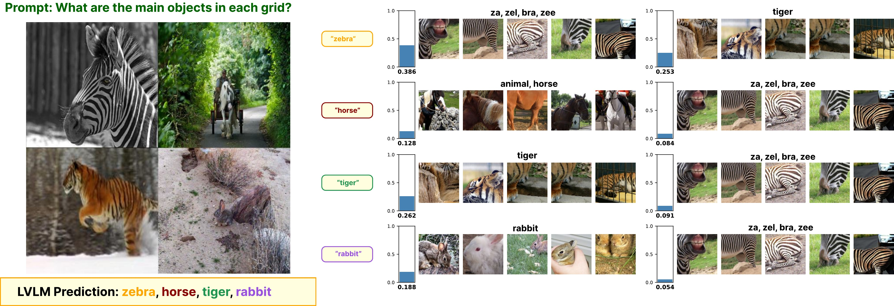
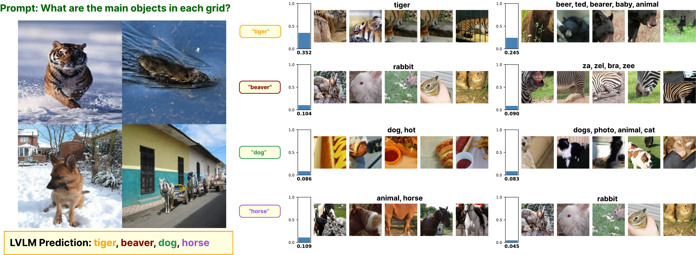
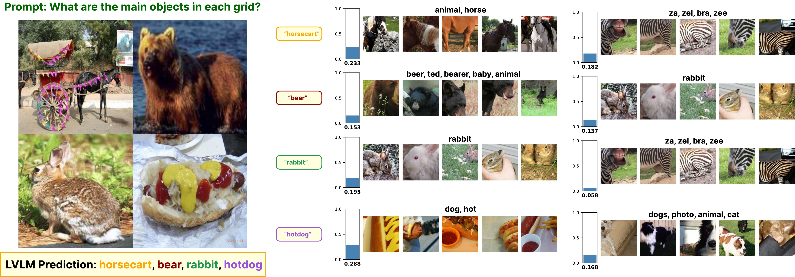

# TGCL: token-grounded concept learning for vision-language models

TGCL explains the words a vision-language model (VLM) generates with concepts
learned from the model's own answers. For every class it asks the VLM about
image segments ("Classify the image as either *bench* or *No bench*"), records
the hidden state of the class word in the answer, and decomposes these states
into a few concept directions per class. At test time every generated word is
explained by the concepts closest to its hidden state, each grounded in
**words** (decoded from the concept direction) and **image segments** (the
training segments that activate it most).





*The VLM names the main object in each cell of a 2×2 image grid. For every
generated word, TGCL shows its two closest concepts: the similarity (bar), the
concept's words and its top training segments.*

The repository holds the pipeline, the three baselines run under the same
protocol (CoX-LMM, CRAFT, MCD) and the evaluation. The extracted concepts of
the paper are released on Hugging Face
([`abka03/TGCL-LVLM`](https://huggingface.co/datasets/abka03/TGCL-LVLM)), so the
tables can be rebuilt without extracting concepts again.

## Installation

```bash
git clone -b release https://github.com/Mak-Ta-Reque/TGCL-LVLM && cd TGCL-LVLM
conda create -n tgcl python=3.10 && conda activate tgcl
pip install -r requirements-lock.txt   # exact versions (torch 2.8.0, CUDA 12.8)
pip install -e . --no-deps             # the tgcl package
cp .env.example .env                   # set HF_TOKEN and cache paths
pytest tests/                          # CPU, about 20 s
```

Gemma-3n (`google/gemma-3n-E4B-it`) is gated: `HF_TOKEN` must belong to an
account that accepted its license. Every Hugging Face model loads at the commit
pinned in `tgcl/models/revisions.py`. The paper runs used RTX 3090 GPUs (24 GB).

## Reproducing the tables

Three entry points, from fastest to complete. All write the same tables:

| | Needs | Time |
|---|---|---|
| **A. From the released results** | the Hugging Face download | minutes, CPU |
| **B. Re-evaluate the released concepts** | the download, a GPU, Gemma-3n (and the datasets for CLIP/BERT) | hours |
| **C. From the beginning** | the datasets, GPUs | days |

### A. Tables from the released results

```bash
huggingface-cli download abka03/TGCL-LVLM --repo-type dataset --local-dir artifacts
for ds in coco10 imagenet1k; do tar -xzf artifacts/evaluation/$ds.tar.gz -C artifacts/evaluation; done

# concept quality: Sparsity, Instability, Overlap (from the concept banks)
for ds in coco10 imagenet1k; do
  python scripts/dictionary_metrics.py --spec configs/dictionary_metrics/gemma3n_$ds.json \
      --out outputs/tables/${ds}_concepts.csv
done
python scripts/dictionary_table.py --csv ImageNet=outputs/tables/imagenet1k_concepts.csv \
    --csv MSCOCO=outputs/tables/coco10_concepts.csv --out outputs/tables/concept_quality.csv

# test images: Acc, F1, faithfulness gap, CLIP, BERT (from the per-run results)
python scripts/evaluate_banks.py table --out artifacts/evaluation/coco10
python scripts/evaluate_banks.py table --out artifacts/evaluation/imagenet1k
```

The test-set tables are printed per setting and written to
`artifacts/evaluation/<dataset>/results.csv`; `artifacts/tables/` holds the
same tables as released.

### B. Re-evaluate the released concepts

The explainer's answers and hidden states on the test images
(`artifacts/test_states/`) do not depend on the concept bank, so every bank is
re-ranked against them on the CPU (Acc / F1), and pipeline step 7 computes the
faithfulness curves, CLIP/BERT and word alignment on the GPU:

```bash
python scripts/evaluate_banks.py build --spec configs/dictionary_metrics/gemma3n_coco10.json \
    --source 'artifacts/test_states/coco10/seed{seed}' --out outputs/evaluation/coco10
python scripts/evaluate_banks.py run --out outputs/evaluation/coco10 --dataset-preset coco
python scripts/evaluate_banks.py table --out outputs/evaluation/coco10

python scripts/evaluate_banks.py build --spec configs/dictionary_metrics/gemma3n_imagenet1k.json \
    --source artifacts/test_states/imagenet1k --out outputs/evaluation/imagenet1k --per-class 1
python scripts/evaluate_banks.py run --out outputs/evaluation/imagenet1k --dataset-preset imagenet1k_quick
python scripts/evaluate_banks.py table --out outputs/evaluation/imagenet1k
```

`build` prepares TGCL's concepts as the method uses them and re-grounds their
words, so it loads Gemma-3n's output head. Acc / F1 and the
faithfulness curves need only the download and the model; CLIP/BERT and word
alignment also read the training images of the grounding segments (see C for
the data). On ImageNet-1k, faithfulness and CLIP/BERT use the first test image
of every class (1,000), Acc / F1 all 10,000. `evaluate_banks.py curves --out
<dir>` recomputes only the faithfulness curves, with one model load per GPU.

### C. From the beginning

```bash
# COCO-10: the 10 most frequent COCO objects, 300 train / 50 test images each
python preprocessing/build_coco10_dataset.py --top-k-common 10 --download \
    --coco-root data/coco_raw --output-dir data/coco_common10
python preprocessing/build_coco10_masked_grids.py \
    --manifest data/coco_common10/manifest.json --output-root data/coco_common10
python scripts/build_coco_captions.py --annotations data/coco_raw/annotations \
    --out data/coco_common10/captions.json

# ImageNet-1k (gated ILSVRC/imagenet-1k), then its quick subset: 20 train / 10 test per class
python preprocessing/build_imagenet1k_dataset.py --train-per-class 300 --test-per-class 50
python preprocessing/build_subset.py --source data/imagenet1k \
    --out data/imagenet1k/subsets/imagenet1k_quick --train-per-class 20 --test-per-class 10 --num-grids 100

# every concept bank and test state of the tables, into artifacts/ (the released layout)
python scripts/extract_concepts.py --dataset coco10
python scripts/extract_concepts.py --dataset imagenet1k
```

`extract_concepts.py` runs pipeline steps 1–5 for TGCL (SAM segments, sliding
windows), CoX-LMM, CRAFT and MCD with three seeds and three decompositions
(semi-NMF, SAE, SIMPLE), and TGCL's step 6 on the test images in the four
settings. Then run A's concept-quality commands and B unchanged. `--dry-run`
lists the jobs; they run on the free GPUs and resume when re-run.

One run by hand (all settings are environment variables; `configs/paper/*.env`
holds the paper values, `.env.example` documents them):

```bash
( set -a; . configs/paper/common.env; . configs/paper/coco.env; . configs/paper/tgcl_sam.env; set +a
  DEVICE=cuda:0 python scripts/run_full_pipeline.py --output-dir outputs/tgcl_sam_coco_seed1 )
```

| Step | Module | Output in the run directory |
|---|---|---|
| 1. Classes: the VLM lists the objects of every training image | `tgcl/inference/dataset_inference.py` | `inference/concepts_to_images.json` |
| 2. Segments: SAM masks without class prompt, or sliding windows | `tgcl/preprocessing/crops_to_json.py` | `inference/crops.json` |
| 3. Layer selection by logit lens (off in the paper) | `tgcl/helpers/layer_selection.py` | |
| 4. Features: the class word's hidden state in the answer per segment | `tgcl/save_features.py` | `features/` |
| 5. Concepts: per-class decomposition, purity filter, combined bank | `tgcl/analyse_features.py`, `scripts/sparsify_concepts.py` | `concept/<method>/` |
| 6. Explanations: answers on the test images, concepts per answer token | `tgcl/inference/vlm_explainer_multibatch.py` | `explanations/<method>/` |
| 7. Evaluation: concept insertion/deletion, CLIP/BERT, word alignment | `tgcl/evaluation/` | `eval/<method>/` |
| 8. Plots | `tgcl/reporting/plot_concept_curves.py` | `eval/<method>/concept_curves.png` |

## Methods

| Method | Step-4 prompt | Segments | Feature | Concepts |
|---|---|---|---|---|
| **TGCL** | binary class prompt | SAM masks without class name, or sliding windows | class word in the answer | per class, semi-NMF |
| CoX-LMM (Parekh et al., 2024) | "What are the objects in the image?" | whole image | class word in the answer | pooled |
| CRAFT (Fel et al., 2023) | none | sliding windows | last input token | pooled |
| MCD (Grobrügge et al., 2025) | none | SAM masks, black background | last input token | pooled |

Every method is decomposed with semi-NMF, SAE and SIMPLE (top-norm prototypes)
on the same training images; the baselines keep every learned component (10
concepts on COCO-10, 1,000 on ImageNet-1k) and are matched as in their own
pipelines (TGCL centred on its calibration mean, the baselines plainly).

## Metrics

| Metric | Code | Meaning |
|---|---|---|
| Sparsity ↑ | `tgcl/reporting/dictionary_metrics.py` | Gini index of each concept vector's coordinates |
| Instability ↓ | `tgcl/reporting/dictionary_metrics.py` | 1 − Hungarian-matched cosine between the banks of different seeds |
| Overlap ↓ | `tgcl/reporting/dictionary_metrics.py` | mean \|cos\| between concepts (coordinates below 1 % of the L2 norm dropped) |
| Acc ↑, F1 ↑ | `scripts/evaluate_banks.py` | top-1 accuracy and macro F1 of the rank-1 concept's class vs the test image's class |
| Gap ↑ (faithfulness) | `tgcl/evaluation/concept_insertion_deletion.py` | the concepts, ordered by activation on the answer's hidden state, are deleted from it one by one or inserted back into its concept-free part; gap = area(insertion) − area(reversed deletion) of the generated token's probability, minus the same gap in random order |
| CLIP ↑, BERT ↑ | `tgcl/evaluation/clip_bert_score_eval.py` | answer word vs the rank-1 concept's grounding segments (CLIPScore) and class name (BERTScore) |

Test-set metrics are reported in four settings: MCQ (multiple choice with the
image, the main one), image-only (open question), text-only (no image) and
combined (yes/no question).

## Released data

[`abka03/TGCL-LVLM`](https://huggingface.co/datasets/abka03/TGCL-LVLM)
(about 1.4 GB, no images: only paths into the datasets):

```
concepts/<dataset>/<method>_seed<s>/concept/<decomposition>/combined_concept_*.pth
        concept bank: concepts (K x 2048), class names, words, grounding segments
test_states/coco10/seed<s>/, test_states/imagenet1k/
        explanations[_<setting>]/snmf/vlm_explanations.json   answers, per-token concepts
        explanations[_<setting>]/snmf/vlm_explanations_activations.npy   hidden states
        explanations[_<setting>]/snmf/vlm_explanations_center.npy   calibration mean
evaluation/<dataset>.tar.gz   per-run results of the tables (Acc/F1, curves, CLIP/BERT)
tables/                       the final tables (CSV)
```

## Repository layout

```
tgcl/            the package: models, segments, features, decomposition, explainer,
                 evaluation (concept insertion/deletion, CLIP/BERT, word alignment), reporting
scripts/         run_full_pipeline.py (one run), run_experiments.py (scheduled runs),
                 extract_concepts.py, evaluate_banks.py, dictionary_metrics.py,
                 dictionary_table.py, sparsify_concepts.py, rerank_explanations.py,
                 paper_report.py, plot_explanations.py, merge_concept_shards.py
preprocessing/   dataset builders (COCO-10, ImageNet-1k and its subsets)
configs/paper/   presets of the paper runs (common, dataset, method, evaluation setting)
configs/dictionary_metrics/   the runs behind every table row (the released concepts)
tests/           unit and integration tests (CPU)
```

## License

The code and the released data (`abka03/TGCL-LVLM`) are under the MIT
license, see `LICENSE`. The code builds on xl-vlms (MIT, © 2024 mshukor),
whose notice is kept. The data holds no images; the COCO and ImageNet images
it refers to remain under their own terms, and the hidden states come from
Gemma-3n, whose use is governed by the Gemma Terms of Use.
